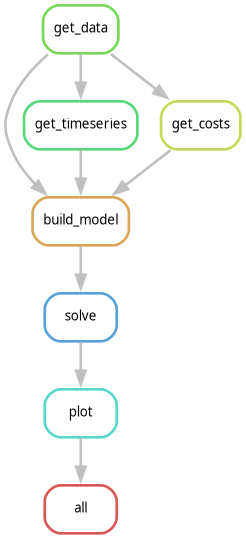

# ENTSO-E training · Reproducible and automatable workflows

Material for the session "Reproducible and automatable workflows" of the ENTSO-E training by [Open Energy Transition](https://openenergytransition.org), 17 November 2026.

Goal: run the same PyPSA model in four ways, from one monolithic script to an automated workflow, and see what each step adds.

The model is Step 3 of the [Hands on with PyPSA components](../02-hands-on-pypsa/hands-on-pypsa-components.ipynb) notebook, with the CO₂ limit of its Task 3: a capacity expansion model of Germany in 2035, with electricity, hydrogen, wind and solar capacities capped at the TYNDP 2026 National Trends+ fleet, and CO₂ emissions capped at 93 Mt/a. You do not need to understand the model code. Look at how the code is split and how the steps are chained.

## Requirements

The requirements of the [Setup](../README.md#setup) apply. The model reads the TYNDP time series from [`../02-hands-on-pypsa/data`](../02-hands-on-pypsa/data) and downloads the technology cost data from `raw.githubusercontent.com`.

Stages 2 and 3 also need `bash` and `make`. macOS and Linux have both. On Windows, see [Troubleshooting](#troubleshooting).

## 1 · Set up

Download this repository and create the environment `.venv`, as the [Setup](../README.md#setup) explains. The environment includes Snakemake.

## 2 · Run the workflow

Activate the environment and open a terminal in this folder (`03-reproducible-workflows`). All paths are relative to it. Then run the four stages in order. Each stage gives the same result: a total system cost of about 66 bn €/a and a CO₂ price of about 86 €/t.

```sh
python 1-monolith/PyPSA-cem.py                # 1) Monolithic script
bash 2-scripts/run.sh                         # 2) Modular scripts, one by one
make -f 3-make/Makefile clean                 #    Delete the files of stage 2
make -f 3-make/Makefile                       # 3) Workflow with Make
make -f 3-make/Makefile clean                 #    Delete the files of stage 3
snakemake -s 4-snakemake/Snakefile --cores 1  # 4) Workflow with Snakemake
```

Stages 2 to 4 write the same files to `data/` and `results/`. Make and Snakemake skip a step when its output is up to date. Without `clean`, stages 3 and 4 find the files of the previous stage and print "Nothing to be done".

### Stage 1 · Monolithic script

File: [`1-monolith/PyPSA-cem.py`](1-monolith/PyPSA-cem.py).

One script reads the data, processes the costs and time series, builds the network, solves it and shows the results. It is easy to start with. But to change one step, you must run all of them again, and you cannot reuse a step in another project.

### Stage 2 · Modular scripts

Files: [`scripts/`](scripts) and [`2-scripts/run.sh`](2-scripts/run.sh).

The monolith is split into six scripts, one per step. Stages 2 to 4 share them. Each script reads its inputs from files, and writes its outputs to files in `data/` or `results/`:

| Script | Input | Output |
|---|---|---|
| `1_get_data.py` | technology-data (download), `../02-hands-on-pypsa/data` | `data/costs_2035.csv`, `data/tyndp2026-*.csv` |
| `2_get_costs.py` | `data/costs_2035.csv` | `data/costs.csv` (annualised costs) |
| `3_get_timeseries.py` | `data/tyndp2026-nt2035-hourly-demand-wind-solar.csv` | `data/timeseries.csv` (6-hour resolution) |
| `4_build_model.py` | `data/costs.csv`, `data/timeseries.csv`, `data/tyndp2026-nt2035-wind-solar-capacity.csv` | `results/cem.nc` |
| `5_solve.py` | `results/cem.nc` | `results/solved_cem.nc` |
| `6_plot.py` | `results/solved_cem.nc` | `results/figure.png` |

Each script has a `main()` function that does the work, and a `__main__` block that reads and writes the files. The scripts give the paths in three ways: hard-coded, as command-line arguments, or from Snakemake.

The shell script runs the six scripts in order. You still decide the order, and it runs every step each time, even if nothing changed. Look at the resolution: `3_get_timeseries.py` and `4_build_model.py` each define it. If you change only one, the model is wrong without an error.

### Stage 3 · Workflow with Make

File: [`3-make/Makefile`](3-make/Makefile).

Each rule names a target file, the files it depends on, and the command that makes it. Make builds the graph of dependencies, and runs only the steps whose inputs are newer than their outputs. Edit `scripts/6_plot.py` and run `make -f 3-make/Makefile` again: only the plot runs. `make -f 3-make/Makefile clean` deletes the files in `data/` and `results/`.

### Stage 4 · Workflow with Snakemake

File: [`4-snakemake/Snakefile`](4-snakemake/Snakefile).

[Snakemake](https://snakemake.readthedocs.io) is a workflow manager written in Python. As Make, it builds a DAG (directed acyclic graph, steps without loops) from the inputs and outputs of its rules. A rule can call a Python script with `script:`, which then reads its paths from the `snakemake` object. Snakemake also creates the output folders, and can run steps in parallel (`--cores`). The file paths of the rules are relative to the folder where you run Snakemake; the `script:` paths are relative to the Snakefile.

Useful commands:

```sh
snakemake -s 4-snakemake/Snakefile --cores 1 --dry-run              # Show the steps that would run, without running them
snakemake -s 4-snakemake/Snakefile --cores 1 results/solved_cem.nc  # Make one file and its dependencies only
snakemake -s 4-snakemake/Snakefile --cores 1 --forceall             # Run all steps again
snakemake -s 4-snakemake/Snakefile --rulegraph | dot -Tpng > 4-snakemake/rulegraph.png
```

The last command needs [Graphviz](https://graphviz.org). [`4-snakemake/rulegraph.png`](4-snakemake/rulegraph.png) shows its result:



Large models use the same structure. The [PyPSA-Eur](https://github.com/PyPSA/pypsa-eur) and [Open-TYNDP](https://github.com/open-energy-transition/open-tyndp) workflows chain hundreds of such rules.

## Troubleshooting

See the [Troubleshooting](../README.md#troubleshooting) of the Setup. Specific to this session:

| Symptom | Cause | Fix |
|---|---|---|
| `'bash' is not recognized` (Windows) | Windows has no bash | Use **Git Bash**, which comes with [Git for Windows](https://git-scm.com/download/win), or run the six commands of `2-scripts/run.sh` one by one |
| `'make' is not recognized` (Windows, Git Bash) | Windows and Git Bash have no Make | Install it with `winget install ezwinports.make`, or skip to stage 4: Snakemake runs on Windows |
| `Nothing to be done` (Make or Snakemake) | The files in `data/` and `results/` are up to date | Run `make -f 3-make/Makefile clean`, or add `--forceall` to the Snakemake command |
| `FileNotFoundError: ../02-hands-on-pypsa/data/...` | The terminal is not in `03-reproducible-workflows` | Change to this folder, then run the command again |

## Licence

The code is derived from Fabian Neumann's [Data Science for Energy System Modelling](https://fneum.github.io/data-science-for-esm/) course (MIT for code, CC-BY-4.0 for content), in particular the [PyPSA Capacity Expansion Modelling](https://fneum.github.io/data-science-for-esm/dsesm/workshop-pypsa-cem/) notebook. It is available under the [MIT License](LICENSE). The model uses the technology costs of [PyPSA/technology-data](https://github.com/PyPSA/technology-data) v0.15.0 (code GPL-3.0; output files: licence not stated), with overwrites from [Open-TYNDP](https://github.com/open-energy-transition/open-tyndp/tree/tyndp-2026) based on TYNDP 2026 (code MIT; `custom_costs.csv` CC-BY-4.0). The TYNDP data are under [CC-BY-4.0](https://creativecommons.org/licenses/by/4.0/); see the [licence of the PyPSA session](../02-hands-on-pypsa/README.md#licence).
